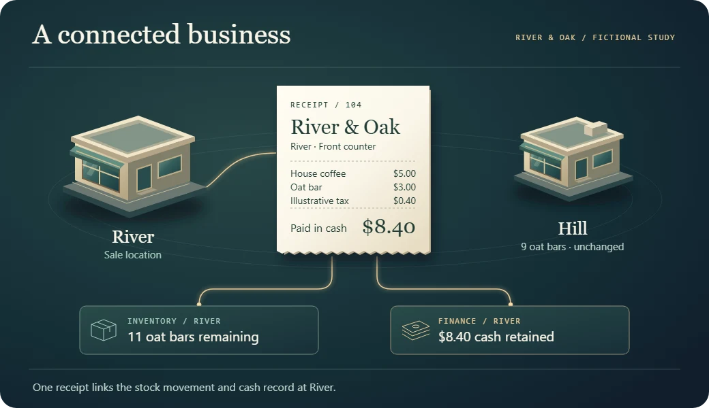

# Mirage Tesseract for Atlasade

**Decision on 24 November 2026 · Defer adoption.** Keep CSS, SVG and semantic HTML for merchant records and interactive education. Tesseract has one persuasive candidate use case here: lighting a dimensional object or storefront once and exporting it for reuse. The public evidence establishes that capability in the engine. It does not establish a visible improvement for Atlasade on this NUC. The commercial evaluation gate is unresolved. No Tesseract executable, project, installer or plugin ran.

[Editable SVG](connected-business.svg) · [Transparent storefront](river-storefront.webp) · [Offline measurement script](measure.py)

## Versions and provenance

Mirage's product page names `mirage-hq/Tesseract` in its setup instructions. The repository links back to that product, the manual install guide and the releases. It publishes agent instructions, interfaces, samples and CLI distributions. It does not expose the complete native engine implementation for an independent source audit. [Mirage product](https://mirage.app/tesseract) · [Official repository](https://github.com/mirage-hq/Tesseract)

| Pin | Verified value |
| --- | --- |
| Distribution | Immutable GitHub release **0.8.0**, 19 November 2026. Tag `v0.8.0` resolves to `d1912394891be215a2dafaeda1b0df2c784d5584` via remote Git refs. |
| Agent documentation | Reviewed main snapshot `d3d271d574c017a485521962a457559ec279a85f`. Its video, 3D and design guides pin CLI 0.8.0. The video skill inside the runtime tag still pins 0.7.0. Keep the two commits distinct. |
| Windows x86-64 ZIP | 189,577,320 bytes. Publisher SHA-256 `2dcbeda3d216af3669342a58b1e62f794b8cce9f4a73175124cf177af6a3a29b`. |
| Apple Silicon ZIP | 148,156,798 bytes. Publisher SHA-256 `3495f1b8f13cb5d5c18139b4f20e1d12635ca5755049343f70c34c3551178eb1`. |
| Website comparison | Isolated documentation branch from published website design/coverage commit `461614980e3382018973656483caf5fdec14a598`. Deployment workflow targets `main`. No site build, merge, deployment or website runtime change. |

Sizes and digests are release metadata. Neither archive was downloaded or locally hashed. GitHub marks the release commit verified. The Windows program itself is unsigned. [Release](https://github.com/mirage-hq/Tesseract/releases/tag/v0.8.0) · [Asset metadata](https://api.github.com/repos/mirage-hq/Tesseract/releases/tags/v0.8.0) · [Matching skill pin](https://github.com/mirage-hq/Tesseract/blob/d3d271d574c017a485521962a457559ec279a85f/skills/tesseract-3d/references/cli-version.txt) · [Tag-era skill pin](https://github.com/mirage-hq/Tesseract/blob/d1912394891be215a2dafaeda1b0df2c784d5584/skills/tesseract-video/references/cli-version.txt)

## Commercial and security review

Mirage's 21 September 2026 terms include business evaluation and internal testing in commercial use. A for-profit commissioning business with at least US$1 million in aggregate worldwide gross revenue over the preceding twelve months needs an executed Mirage agreement expressly authorizing that use. The definition covers entities under common control, excludes investment and loan proceeds, and avoids double-counting intercompany revenue. A different agent account or a paid Captions subscription does not establish eligibility. Eligibility was not established for this run. Only categorical confirmation is needed to revisit the evaluation. [Terms §§2.2.1–2.2.4](https://mirage.app/legal/tesseract-terms) · [Release terms](https://github.com/mirage-hq/Tesseract/blob/d1912394891be215a2dafaeda1b0df2c784d5584/TERMS.md)

The qualifying local license is royalty-free, subject to its restrictions, including competing uses. Mirage retains the engine. The user owns lawful inputs and outputs as between the parties, subject to third-party rights. Shipping an original rendered illustration has a different rights footprint from shipping the engine, sample projects, embedded fonts or stock media. No paid rendering service, Adobe account or Mirage account is required for ordinary local rendering. Agent usage is separate. Enterprise pricing was not established. Release notices cover bundled components including FFmpeg under LGPL 2.1 or later, FDK-AAC and Inter. This study uses original SVG geometry and system font references, with no embedded fonts, sample media or copied third-party illustration. [Terms](https://mirage.app/legal/tesseract-terms) · [Release notices](https://github.com/mirage-hq/Tesseract/blob/d1912394891be215a2dafaeda1b0df2c784d5584/THIRD_PARTY_NOTICES.md) · [Mirage pricing explanation](https://mirage.app/tesseract)

| Surface | Assessment |
| --- | --- |
| Local processing | The local CLI reads media and writes projects, previews and exports under the agent's filesystem permissions. Ordinary composition uses the local renderer. Hosted agent execution changes where the files are processed. Optional signed-in MCP and Captions cloud services are separate. Neither is needed here. |
| Network | GitHub serves downloads and checksums. Apple may contact notarization services. The first denoised path trace downloads model weights. Some optional audio processing also downloads models. Use original local geometry and local media for a bounded test. |
| Telemetry | Enabled by default. Documented events bracket project creation, preview, filmstrip and export. Fields include command, version, platform, optional agent attribution, installation/run/event identifiers, duration and outcome. Mirage says prompts, media contents, filenames, paths, raw arguments and error text are excluded. Opt out with `tsrct telemetry disable` and verify with `tsrct telemetry status` before creating anything. The setting persists under the user profile. |
| Assurance limit | No installer was executed, no plugin was registered and no binaries were reverse-engineered. No packet capture or binary behavior test was possible. Exact telemetry endpoints and default egress are unverified. A published checksum checks integrity against the publisher's artifact. It cannot independently establish benign behavior. |

[Local operation](https://github.com/mirage-hq/Tesseract/blob/d3d271d574c017a485521962a457559ec279a85f/skills/tesseract-3d/references/local-operation.md) · [Telemetry contract](https://github.com/mirage-hq/Tesseract/blob/d3d271d574c017a485521962a457559ec279a85f/skills/tesseract-video/references/telemetry.md) · [Privacy policy](https://mirage.app/legal/privacy-policy) · [Scene rendering](https://github.com/mirage-hq/Tesseract/blob/d3d271d574c017a485521962a457559ec279a85f/skills/tesseract-3d/references/scene3d-basics.md)

## Rendering, platforms and installation

Codex can call the native `tsrct` executable directly. Its schema describes typed project actions. The agent can create named layers, inspect a scene, apply a small action batch, render a specific time, review filmstrips and revise individual objects. Scene3D exposes meshes, materials, cameras and lighting. Raster is the default for quick layout. Native path tracing adds bounce light, soft shadows, reflection and refraction at higher cost. Renderer and sample count are command settings. Save them alongside the project for reproducibility. A browser player uses raster even for a project previously exported with path tracing. [3D authoring](https://github.com/mirage-hq/Tesseract/blob/d3d271d574c017a485521962a457559ec279a85f/skills/tesseract-3d/SKILL.md) · [Renderer options](https://github.com/mirage-hq/Tesseract/blob/d3d271d574c017a485521962a457559ec279a85f/skills/tesseract-3d/references/scene3d-basics.md)

| Platform or resource | Evidence and qualification |
| --- | --- |
| Windows NUC | CIM reported Windows 11 Pro x64 build 26300, Core Ultra 9 285H, Arc 140T integrated GPU, driver 32.0.101.9175, and 100,163,856 KiB visible RAM (95.52 GiB). The GPU name includes “48GB”. Treat that as the reported label on an integrated GPU. |
| GPU and disk | Installed `vulkaninfo --summary` enumerated the Arc device, device API 1.4.359, Vulkan instance 1.4.350. It also warned about a layer-manifest registry lookup. About 505 GiB free on C: at inspection. These checks verify the host and functioning Vulkan enumeration. A Tesseract frame, device limits, encoder and peak working set on Arc remain unqualified. |
| Windows installation | Published target is AMD64 Windows 10 or later with runtime libraries bundled. Manual path uses the ZIP and sidecar, verifies SHA-256, extracts, then invokes the packaged PowerShell installer. Default wrapper lives in the user's local AppData. No documented administrator, Rust, Node, paid service or additional driver prerequisite for this Windows flow. Review the actual script and its destinations before execution. The documented PowerShell policy switch is not approval to relax host security. Stop on SmartScreen/application control or any newly required system change. |
| Macs | Separate native arm64 and x86-64 bundles. Choose arm64 on Apple Silicon, including a shell translated by Rosetta. The release guide describes Developer ID signing, notarization and per-user installation. The installer checks the minimum OS. Exact compatible macOS build on a particular Mac, GPU throughput and export success were not verified. |
| Linux | x86-64, glibc 2.35+, Python 3, bash, coreutils and unzip for installation. Runtime requires zlib, ALSA, libstdc++, Vulkan loader and compatible driver. Lavapipe can render in software. Linux H.264 requires a separate FFmpeg with libx264 and AAC selected explicitly. |
| Sizing | No numerical minimum core count, RAM, dedicated VRAM, or installed free-space requirement found in the pinned guide. Archive sizes are lower bounds on storage planning. Packaged media, repeated project checkpoints, intermediate stills and model caches add to the extracted engine. |

[Official installation entry point](https://github.com/mirage-hq/Tesseract/blob/d3d271d574c017a485521962a457559ec279a85f/skills/tesseract-video/references/installation.md) · [Platform and installer details](https://github.com/mirage-hq/Tesseract/blob/d3d271d574c017a485521962a457559ec279a85f/skills/tesseract-video/references/install-cli.md)

| Output | What the reviewed interface supports |
| --- | --- |
| Editable | Native portable `.tsrct` retains authored layers, text, geometry, keyframes and packaged assets. Keep source references and authoring actions. Premiere and After Effects conversions are partial, with experimental After Effects export, via separately versioned conversion tooling. |
| Stills and vector | `preview` produces raster PNG, and `filmstrip` produces a contact sheet. SDR is appropriate for this site. HDR preview supports tagged 16-bit PQ PNG. No documented general-purpose layered SVG, WebP or AVIF **export** found. Editable vector-like shapes and image import support do not guarantee those delivery formats. |
| Motion | Default H.264/AAC MP4 at 1080p/30. The CLI documents 720p, 1080p and 4K, selectable frame rate and timeline ranges. HDR delivery uses HEVC Main 10 PQ or HLG. macOS documents ProRes 4444 MOV and silent solo-layer/group export with alpha. Windows alpha video is unverified. |
| Browser compositing | A full render flattens labels and records. Isolate decorative elements, render alpha where supported and inspect the result against cream and midnight. Glass over a transparent backdrop can retain opaque coverage. Do not assume a clean matte from the file extension. |

[Documented outputs](https://github.com/mirage-hq/Tesseract/blob/d3d271d574c017a485521962a457559ec279a85f/skills/tesseract-video/references/capabilities.md) · [Static design](https://github.com/mirage-hq/Tesseract/blob/d3d271d574c017a485521962a457559ec279a85f/skills/tesseract-design/references/static-authoring.md) · [Mirage conversion limitations](https://mirage.app/tesseract)

## Quiet Orbit comparison

The merchant question is “Which location did this receipt affect?” The original vector study lights the River storefront, holds one upright cream receipt in focus and attaches two gold paths to the records it explains. Hill is quieter and has no transaction connector. Inventory and finance have written labels as well as distinct symbols. The second location remains visible for comparison. Node executed the existing scenario transitions and returned receipt 104, total 840 cents, River stock 11, Hill stock 9, and cash retained 840 cents. The illustration is a fixed example of that state. [Scenario](../../../src/day/scenario.ts) · [Working receipt view](../../../src/SalePortrait.jsx)

| Criterion | Observed CSS/SVG control | Tesseract assessment |
| --- | --- | --- |
| Visual quality, depth and light | The architectural miniatures read as storefronts. Roof, side plane, lit glazing and soft shadows provide depth. Upper-left light and the cream paper establish a clear focal point. Both storefronts share a visibly repeated model. | Editable true geometry, indirect lighting and material response could improve a close-up or changing camera angle. No matched image was produced. A comparative quality score would be speculative. |
| Typography and revision | Upright text uses local serif, interface and monospace stacks. Each record has a named group. Text and endpoints can be edited directly. System font metrics can vary across machines. | Editable native text and layers are attractive for a fixed campaign composition. Exported text becomes pixels. Revisions require the engine, project and matching fonts. |
| Agent reliability and reproducibility | The checked-in SVG and five repeated captures in one browser produced identical pixels. No installation was needed for authoring. | Schemas and small batches make revisions inspectable. Renderer settings, version, device, fonts and model availability affect reproduction. No Atlasade success rate or cross-host repeatability measured. |
| Responsive and accessible use | A 390 px-wide capture preserved the hierarchy but made 14-unit receipt rows about 5.25 CSS pixels high. It fails as a mobile reading surface. The SVG has a title and description. Embedded raster needs alt text or equivalent nearby HTML. | Rendering more pixels cannot solve that layout. Use a transparent object crop with live HTML records that can reflow, zoom and expose labels to assistive technology. No Tesseract accessibility or responsive test was performed. |
| Website interaction | The existing sale portrait reads the deterministic scenario and traces the selected relationship in the browser. | A still, isolated layer or optional clip can illustrate an outcome. It cannot recalculate tender, stock or cash when a visitor changes input. |

**Design tools.** The Atlasade skill provided the reading order, fictional record, color roles and restrained depth. Quiet Orbit's existing stylesheet is 952 bytes and its shared SVG symbol sheet is 3,848 bytes on disk. MotionSites-style staging is relevant to lighting and directing attention. Every Joule's educational idea applies when a visitor changes an input and can inspect the resulting arithmetic. Keep both the input and explanation live. The Modern Web Guidance search located decorative-image delivery guidance, including the preload-discovery cost of putting a hero in CSS. An above-the-fold illustration should use a sized HTML image or picture. No website implementation was made. [Quiet Orbit](../../quiet-orbit.md) · [Atlasade skill](../../../.agents/skills/atlasade-visual-design/SKILL.md) · [Modern Web Guidance](../../modern-web-guidance.md) · [Every Joule review](../../interactive-product-education-review.md) · [MotionSites](https://motionsites.ai/)

## Resource and export measurements

Measured locally with offline Playwright Chromium 149.0.7827.55, a 1040 × 600 viewport, DPR 1 and reduced motion. The browser was already launched. Each of five iterations navigated to the same local SVG and captured a PNG. File size includes the complete illustration. Gzip represents a possible transfer encoding. These timings include screenshot encoding and are not page-load or Web Vitals measurements.

| Measurement | SVG comparison | Tesseract |
| --- | ---: | --- |
| Editable SVG / gzip level 9 | 7,435 B / 2,541 B | No project or SVG export |
| PNG review still | 380,334 B | Unmeasured |
| WebP at quality 0.88 | 43,218 B | Unmeasured |
| Transparent storefront WebP, 268 × 180 | 10,272 B | Unmeasured |
| Capture time, five runs | 181.09, 144.14, 135.84, 137.15, 129.49 ms. Median 137.15 ms. | Unmeasured |
| CPU time | 0.922 s across browser and automation children for five captures | Unmeasured |
| Highest sampled aggregate working set | 393.66 MiB across browser and automation children, including their baseline | Unmeasured |
| GPU | Windows GPU Engine counters were available, but none matched a measured PID. GPU load is unknown. | Unmeasured |

All five PNGs had SHA-256 `82fede35a14882392ec164d43084c95fd1cb8e4c576de0b739d9381ef7513ef9`. A second invocation produced the same hash. Only file-scheme page requests were observed. The crop has transparent corners. Full-frame and mobile captures were visually inspected. There is no screen-reader, multi-browser, production network, or cross-device performance claim. To reproduce, use the included Python script with an existing Playwright/Chromium and psutil installation. Add `--windows-gpu` for optional English Windows PDH counters via pywin32. From this directory run `python measure.py <local-output-directory>`. Reuse the pinned browser and system fonts for pixel comparison.

## Future integration decision

| Proposed use | Recommendation |
| --- | --- |
| Dimensional environments, storefront cutaways, premium product illustrations | Best candidates for an offline Tesseract trial. Choose one object where the material or shadow communicates something the merchant can see at delivery size. The transparent storefront in this study demonstrates the asset boundary. |
| Register customization | Keep tile order, labels, selection and before/after state in HTML. A prerendered housing or surrounding counter is an optional decorative layer. |
| Enterprise / ERP relationships and educational diagrams | Use local SVG paths and HTML labels bound to the same record IDs. Keep real controls, focus, arithmetic and alternate outcomes in the deterministic engine. Photography or a still may establish setting. |
| Optional short animation | Use a user-initiated clip with a poster, reduced-motion alternative, controls and captions when speech conveys meaning. An inspection animation may show a camera move or material detail. Replaying it must never create a sale or replace a what-if control. |

A future licensed trial can stay entirely in the authoring workspace. Verify the 0.8.0 archive and sidecar against the recorded digest, inspect the installer, check the installed version, disable telemetry, and run a small preview before building the scene. Stop if installation requires elevation, host changes, additional drivers or paid services. Start with local geometry and raster. For an offline path-trace test, use `--renderer path-tracer --samples 16 --no-denoise` as a diagnostic. Record the flags. For a final test assess noise at delivery size, use the documented 128-sample starting point, and evaluate any separate model download before enabling denoising. Keep per-layer names, source rights and an opaque reference render. Reopen the source and reproduce the frame after a targeted revision.

Compare at the same camera, crop and size as this control. Keep the SVG for line art. For shaded artwork, compare SDR WebP at quality 0.85–0.90 and AVIF at matched visible quality on the intended light and dark surfaces. A transparent matte must survive the final encoding. Supply an appropriate small-screen crop with reserved dimensions and accessible HTML. Require a visible gain at actual display size and record delivery bytes, time, peak memory, GPU activity and revision effort before adoption. No Tesseract player, editor, MCP, rendering library or model belongs in the visitor's bundle.

## Process cleanup

No development server, listener, Tesseract runtime, model downloader or persistent service was started. The offline Playwright browser used its own temporary profile. An initial sandboxed attempt stalled before the browser started. Its verified worker (4100, parent 16904) was stopped and its shell command exited. Two successful runs closed normally.

| Purpose | PID → parent PID |
| --- | --- |
| First offline review, driver and Chromium processes | 23032 → 30748, 26296 → 23032, 8296 / 26440 / 26712 → 26296 |
| Instrumented final review, driver and Chromium processes | 19276 → 27332, 27484 → 19276, 2072 / 17700 / 27240 → 27484 |

The benchmark checked process identities after shutdown and found zero surviving browser or driver children in both runs. No task-owned process was retained.
